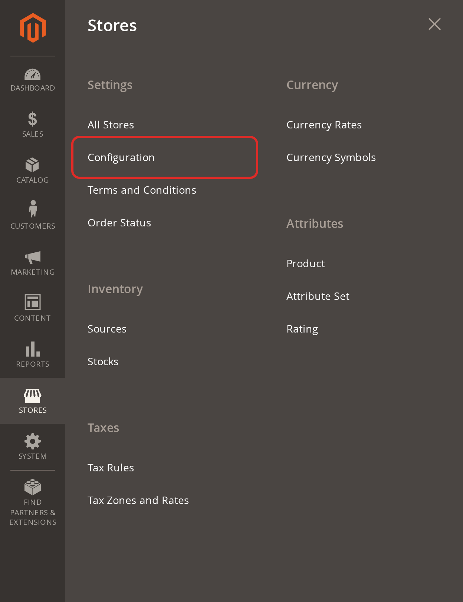
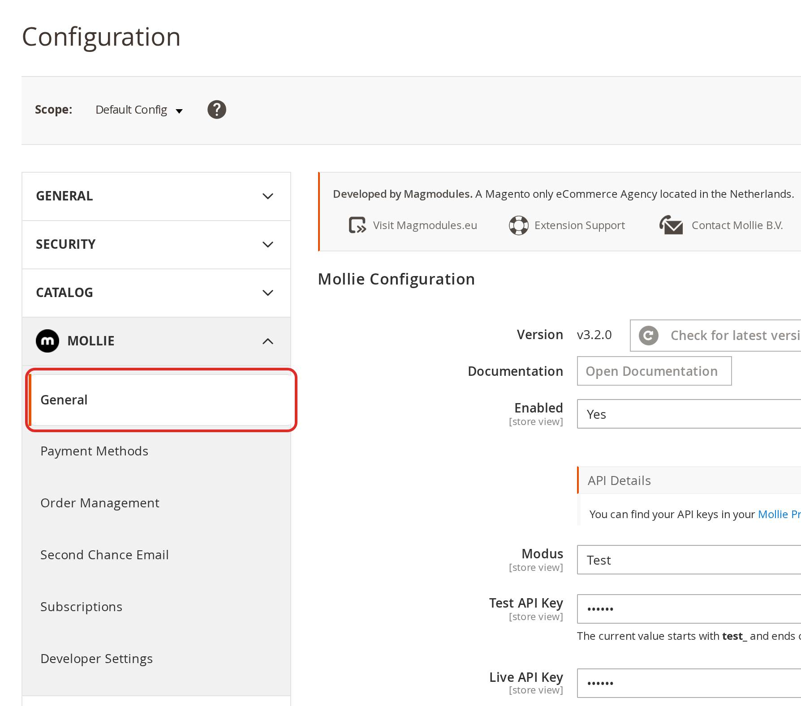
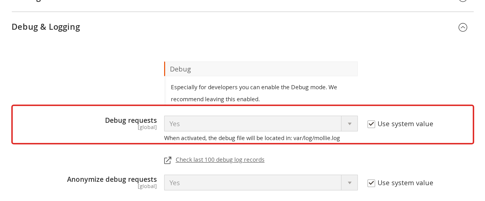
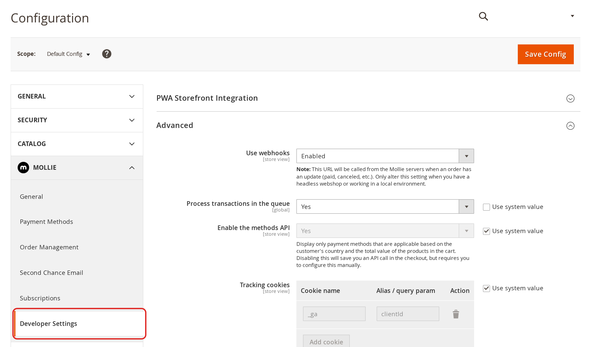

# Debuginformatie delen

Dit artikel legt uit hoe je de debuginformatie downloadt in je Magento Admin en veilig deelt, zodat support je probleem met Mollie Payments for Magento 2 kan onderzoeken.

## Controleer of debug-logging aan staat

De extensie schrijft alleen naar het logbestand als **Debug requests** aan staat. Zonder logbestand mist de debuginformatie de details die support nodig heeft.

1. Ga naar **Stores → Configuration**

   

2. Open **Mollie → General**

   

3. Klap **Debug & Logging** open en controleer of **Debug requests** op **Yes** staat. Is het veld grijs? Haal dan eerst het vinkje bij **Use system value** weg.

   

4. Klik op **Save Config** als je de instelling hebt aangepast

**Belangrijk:** Stond debug-logging uit? Dan staat het probleem nog niet in het logbestand. Wacht tot het probleem opnieuw optreedt, of reproduceer het, voordat je de debuginformatie downloadt.

## De debuginformatie downloaden

De extensie verzamelt de logbestanden, configuratie en omgevingsgegevens in één bestand.

1. Ga naar **Stores → Configuration → Mollie → Developer Settings**

   

2. Klap **Advanced** open
3. Klik op **Download** naast **Download debug information**

   

Je browser downloadt een bestand met een naam als `mollie-debug-20261007-093000.tgz`. Stuur het bestand zoals het is. Pak het niet uit om het opnieuw in te pakken.

## Wat het bestand bevat

Het bestand bevat een `README.txt` die elk bestand beschrijft, zodat je kunt nakijken wat je deelt. In het kort:

- De laatste 10.000 regels van `mollie.log`, `system.log`, `exception.log` en `debug.log`
- De Mollie-configuratie, met API-sleutels alleen in versleutelde vorm
- Je `app/etc/env.php`, met de versleutelingssleutel en alle wachtwoorden weggelaten
- De versies van Magento, PHP en de database, de geïnstalleerde modules, en `composer.json` en `composer.lock`
- De status van de cache, de indexers en recente cronjobs
- De winkel-URL's en de beschikbare betaalmethoden

## Deel het bestand privé

De logbestanden kunnen ordernummers, klantnamen en e-mailadressen bevatten. Voeg het bestand daarom niet toe aan een openbaar GitHub-issue.

1. Ga naar het [supportformulier van Magmodules](https://www.magmodules.eu/support)
2. Voeg het debuginformatiebestand toe
3. Voeg de link naar je GitHub-issue toe als je er een hebt, en de ordernummers waarbij het probleem optreedt

## Volgende stappen

- [Probleemoplossing](TROUBLESHOOTING.md): Ingebouwde diagnosetools en veelvoorkomende problemen
- [Configuratie](CONFIGURATION.md): Alle algemene instellingen uitgelegd
